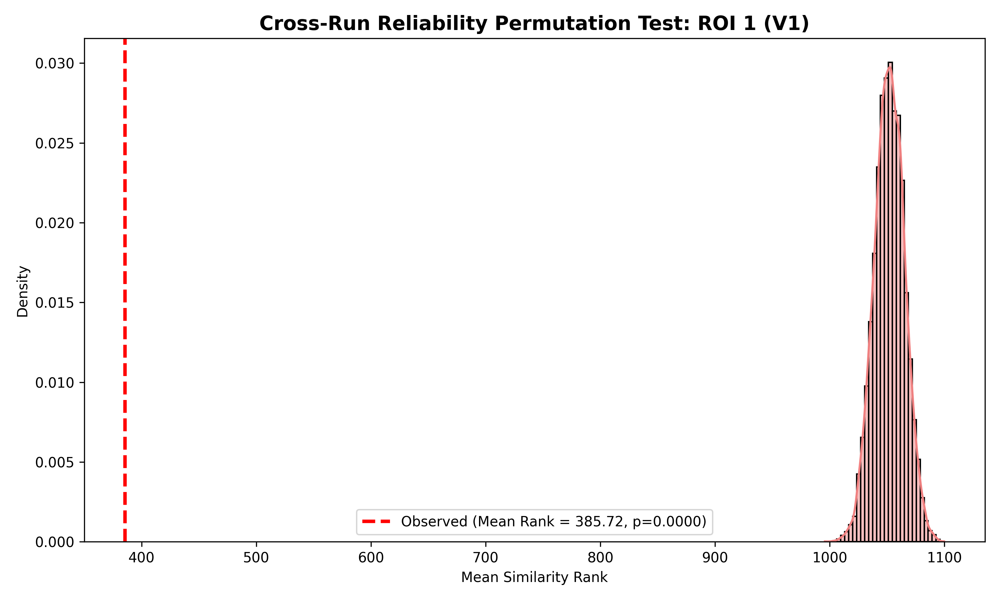
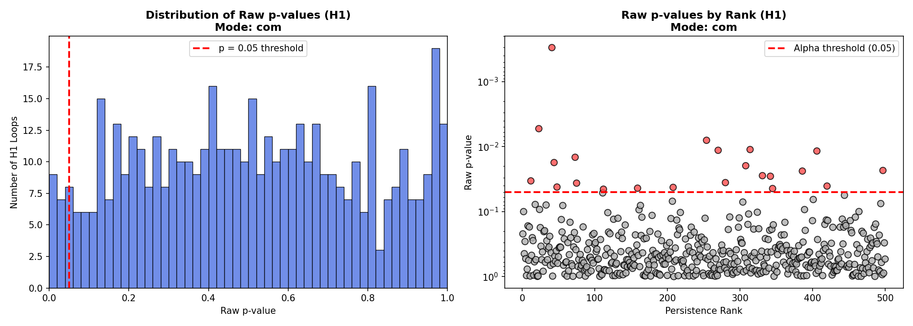
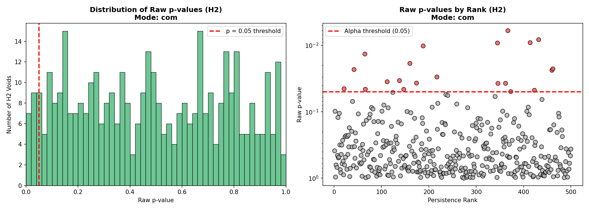
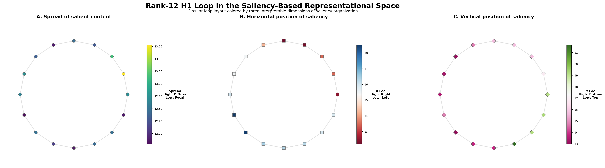
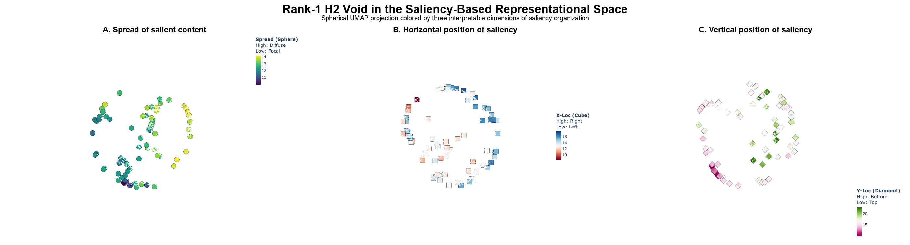
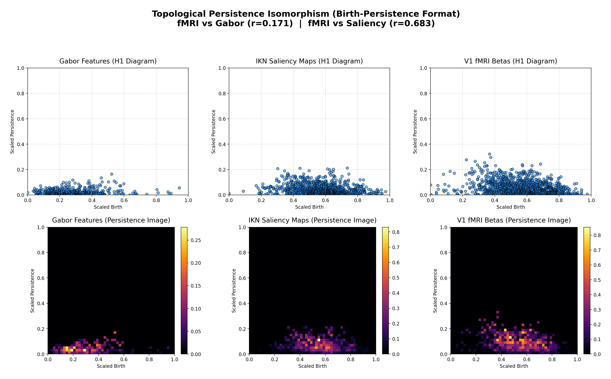

# Topological fMRI Representational Analysis

This repository is a curated portfolio version of my thesis project on **topological structure in visual representations and fMRI response patterns**. The work asks whether image-derived feature spaces contain higher-order shape structure, such as loops and voids, that can also be related to neural representational similarity in visual cortex.

Rather than treating images and brain responses only as pairwise similarity matrices, the thesis used persistent homology to study the *shape* of representational spaces. The project combined Natural Scenes Dataset (NSD) stimuli, repeated-stimulus fMRI beta responses, visual feature models, saliency maps, permutation testing, and persistence-image comparisons.

## Thesis Question

**Can topological structure in image-derived feature spaces reveal organization that is also present in visual cortical fMRI responses?**

The motivation was that ordinary geometry captures local similarity, while topology can capture larger-scale organization: connected components, loops, and voids that persist across distance thresholds. The thesis treated topology as a complement to representational similarity analysis, not as a replacement for it.

## Research Design

The analysis was built around subject-level NSD data and repeated natural-image presentations. Repeated trials made it possible to estimate stable image-level fMRI response vectors before comparing them with image-derived feature spaces.

The thesis focused on three representational sources:

* **fMRI response spaces:** R2-thresholded beta responses from visual ROIs, especially early visual cortex and higher-order ventral visual areas.
* **Gabor feature spaces:** orientation and spatial-frequency structure, motivated by early visual coding.
* **IKN saliency feature spaces:** spatial organization of visually important content, using structural Itti-Koch-Niebur saliency maps.

For each feature space, the pipeline computed persistent homology with Vietoris-Rips complexes. H1 loops and H2 voids were then tested against fMRI similarity using rank-based permutation tests and graph/subgraph null models.

## Key Thesis Figures

### 1. Reliability of the neural signal

Before comparing topology across visual and neural spaces, the thesis first checked whether repeated presentations of the same image produced stable fMRI response patterns. This reliability step was important because topological correspondence would be difficult to interpret if the underlying neural measurements were not repeatable.



### 2. Saliency topology and fMRI correspondence

The IKN saliency analyses asked whether loops and voids in saliency-derived image spaces corresponded to above-chance fMRI similarity. The H1 and H2 landscapes summarize permutation-test p-values across persistence-ranked topological features, rather than only inspecting a single hand-picked representative.





### 3. Interpreting an H1 loop

The H1 loop below is shown as the same circular topology colored three different ways: by spread of saliency, horizontal center of saliency, and vertical center of saliency. This was the interpretability step: a loop is not just a barcode point, but a structured path through images whose salient content changes in an organized way.



### 4. Interpreting an H2 void

The H2 visualization extends the same idea to a spherical void. The same H2 representative is shown three times, colored by saliency spread, horizontal position, and vertical position. In the thesis, this figure was used to make the high-dimensional void interpretable as a structured saliency manifold rather than an abstract persistence feature.



### 5. Whole-diagram comparison

Beyond individual loops and voids, the thesis also compared entire persistence signatures using persistence images. This gave a compact way to compare the global topological profiles of Gabor, saliency, and fMRI spaces.




## What Is Included

This portfolio folder keeps the thesis-relevant analysis code and presentation figures. It intentionally excludes raw NSD images, fMRI beta volumes, ROI masks, and bulk generated outputs because those are large local research assets.

The main implementation files are:

* `src/fmri_permutation_test.py`: repeated-stimulus fMRI reliability control.
* `src/tda_saliency_pval_dist.py`: IKN saliency H0/H1/H2 topology and permutation testing.
* `src/tda_transformedIKN_pval_dist.py`: IKN saliency spatial, Fourier, and center-of-mass transformations with H1/H2 interpretation figures.
* `src/dual_pipeline_h1_h2.py`: Gabor H1/H2 exploratory branch.
* `src/persistence_images.py`: persistence-image comparisons across Gabor, IKN saliency, and fMRI spaces.

The `src/pySaliencyMap/` folder contains the MIT-licensed Itti-Koch-Niebur saliency implementation used by the structural saliency branch.

## Reproducing Locally

```bash
python -m venv .venv
source .venv/bin/activate
pip install -r requirements.txt
```

To rerun the analyses, restore the local NSD/fMRI paths expected by the scripts or edit the path constants near the top of each file. The most important paths are `responses_sub_01.tsv`, the NSD stimulus HDF5 file, subject beta volumes, ROI masks, R2 maps, and the output `SAVE_DIR`.
